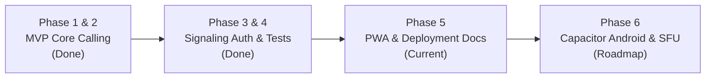

# Regulatory Analysis (DoT India) & Future Roadmap

## 1. India Telecommunications Regulatory Compliance (DoT / TRAI)

### App-to-App Calling vs. Internet Telephony (PSTN Interconnection)

| Calling Scope | Regulatory Classification | Licensing Requirement in India | Status in Voipify |
| :--- | :--- | :--- | :--- |
| **App-to-App (Data)** | Over-The-Top (OTT) Communication Service over IP | No Telecom License required. Governed by IT Act 2000 & Digital Personal Data Protection (DPDP) Act 2023. | **Supported** (Default architecture). |
| **App-to-Phone (PSTN / Mobile)** | Internet Telephony (Interconnected VoIP) | **Strictly Regulated**. Requires Unified License (UL) under Section 4 of the Indian Telegraph Act / Telecommunications Act 2023. | **Not Supported** without authorized telecom provider. |
| **Toll Bypass** | Routing international / inter-circle calls to PSTN | **Prohibited**. Carrying non-licensed voice traffic between IP and PSTN bypasses national long-distance (NLD) tariffs. | **Forbidden**. |

### Crucial Indian Regulatory Constraints:
1. **Logical Partitioning**: Telecom regulations prohibit bridging an internal IP network / private circuit with the public PSTN if it allows routing of PSTN calls over the internet without passing through a licensed TSP gateway.
2. **Lawful Interception**: Providers offering PSTN termination must provide automated interception interfaces for security agencies and maintain Call Detail Records (CDRs) for a minimum of 2 years within Indian borders.
3. **Recommendation**: Keep Voipify strictly focused on end-to-end encrypted app-to-app IP audio calling. If telephone number dialing is required in the future, integrate exclusively with a licensed Indian telecom partner (e.g., Tata Communications, Airtel Business, or Twilio India with local telecom operator interconnects).

---

## 2. Technical Roadmap

### Milestone 1: Android Native Packaging (Capacitor / TWA)
- Wrap Next.js PWA into an Android APK / AAB using `@capacitor/core` and `@capacitor/android`.
- Configure `AndroidManifest.xml` with permissions:
  - `android.permission.RECORD_AUDIO`
  - `android.permission.MODIFY_AUDIO_SETTINGS`
  - `android.permission.FOREGROUND_SERVICE_MICROPHONE`
- Implement Android `ConnectionService` (Telecom Framework) so incoming calls display the native full-screen system incoming call UI.

### Milestone 2: Background Calling & Push Notifications
- Web Push API provides notification banners when the browser is running or in background.
- For 100% reliable wake-ups when the device is locked:
  - **Android**: Firebase Cloud Messaging (FCM) high-priority data messages triggering a native incoming call activity.
  - **iOS**: Apple PushKit (`PKPushRegistry`) with CallKit integration.

### Milestone 3: Multi-Party / Group Calling (SFU Migration)
- Direct mesh WebRTC scales up to 3–4 participants before client bandwidth saturates ($N \times (N-1)$ connections).
- Upgrade to a Selective Forwarding Unit (SFU) using open-source **LiveKit** or **Mediasoup**:
  - Each participant sends 1 audio stream to the SFU.
  - SFU forwards audio streams with selective muting and active speaker detection.

### Milestone 4: End-to-End Encryption (E2EE) with SFrame
- Implement WebRTC Encoded Transform (Insertable Streams) with the SFrame standard (RFC 9605).
- Audio frames are encrypted with AES-GCM before passing to WebRTC packetization, ensuring zero-trust even if the signaling or SFU infrastructure is compromised.
