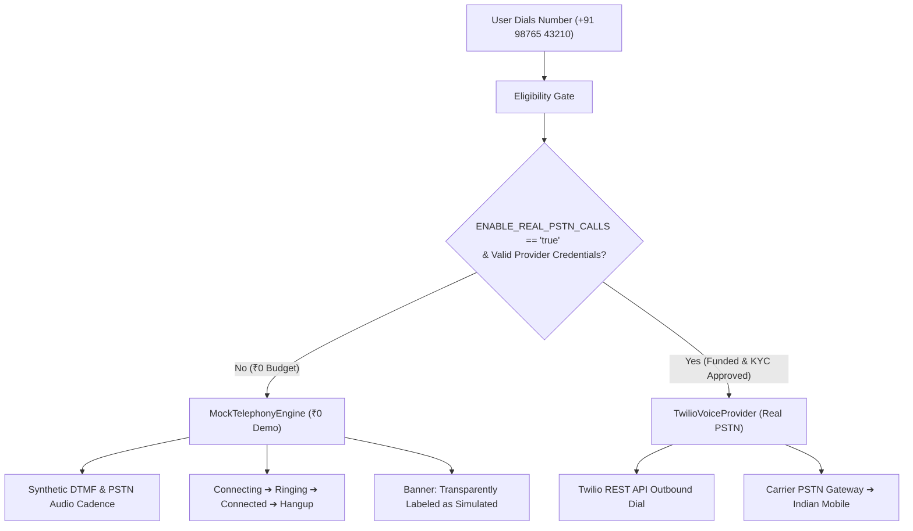

# Telephony Provider Architecture, Regulatory Realities & ₹0 Budget Analysis

## 1. The ₹0 Budget Reality: Why Real Indian Mobile Calls Cannot Be Free

A core requirement of this engineering evaluation is honesty regarding technical, regulatory, and financial boundaries.

### Technical & Commercial Reality:
- **PSTN Termination Incurs Physical Costs**: Calling an arbitrary mobile phone number (where the receiver has no app installed) requires routing the voice call through physical cellular towers (Airtel, Jio, Vi, BSNL) via a licensed telecom gateway.
- **No Free Telephony Carrier Exists**: Cloud telephony APIs (Twilio, Plivo, Exotel, Sinch) are not charitable networks; they pay termination fees to Indian telecom carriers for every single connection minute.
- **Trial Limitations**: While providers offer initial sandbox credits (e.g. Twilio $15 trial), **they strictly restrict outbound calling to pre-verified numbers**. They categorically block dialing arbitrary, unverified phone numbers on trial tiers to prevent spam, fraud, and toll abuse.

---

## 2. Indian Telecom Regulatory Framework (DoT & TRAI)

| Regulatory Body / Act | Mandate | Direct Impact on Internet-to-Phone Calling |
| :--- | :--- | :--- |
| **Department of Telecommunications (DoT)** | Indian Telecommunications Act 2023 / OSP Guidelines | **Prohibition of Toll Bypass**: Bridging internet voice traffic with the Indian Public Switched Telephone Network (PSTN) without passing through a licensed Access Service Provider gateway inside the same telecom circle is illegal. |
| **TRAI (TCCCPR 2018)** | Telecom Commercial Communications Customer Preference Regulations | **Mandatory DLT Registration**: All automated or enterprise voice traffic terminating in India requires registration on telecom Distributed Ledger Technology (DLT) portals with approved Principal Entity IDs and Voice Headers. |
| **Lawful Interception & CDR** | Licensing Section 4 | Telecom gateways must store Call Detail Records (CDRs) for a minimum of 2 years and provide automated interception interfaces for national security agencies. |

---

## 3. Provider Comparison & Real Route Costs

| Provider | India (+91) Rate / Min | KYC & Registration Prerequisites | Trial Limitation |
| :--- | :--- | :--- | :--- |
| **Twilio Voice** | ~$0.024 – $0.045 (~₹2.00 – ₹3.75) | Company KYC, regulatory compliance bundle, international dialing permissions. | Can call only verified numbers. |
| **Plivo Voice** | ~$0.019 – $0.038 (~₹1.60 – ₹3.20) | Business verification and pre-funded balance. | Can call only verified test numbers. |
| **Exotel** (Indian) | ~₹0.60 – ₹1.20 | Indian registered business (GSTIN, PAN) + TRAI DLT registration. | No free tier; minimum wallet commitment ₹10,000+. |

---

## 4. How Voipify Solves This at ₹0 (Dual-Engine Architecture)



1. **Local High-Fidelity Simulation Engine**:
   - Provides an identical user experience to a production telephony client: authentic ITU-T DTMF audio feedback, live E.164 parsing, realistic ringing latency, in-call touch-tone dialpad, call duration tracking, and recent logs.
   - Clearly flags the activity with a prominent **"Simulated Demo Mode (₹0)"** badge.
2. **Pluggable Production Adapter**:
   - `TwilioVoiceProvider` is fully implemented in `src/lib/telephony/providers/twilioProvider.ts`.
   - When the owner funds a telephony wallet, activating real calls requires only setting environment variables:
     ```env
     ENABLE_REAL_PSTN_CALLS=true
     TWILIO_ACCOUNT_SID=ACxxxxxxxxxxxxxxxxxxxxxxxxxxxxxxxx
     TWILIO_AUTH_TOKEN=your_real_auth_token
     TWILIO_PHONE_NUMBER=+12025550199
     ```
